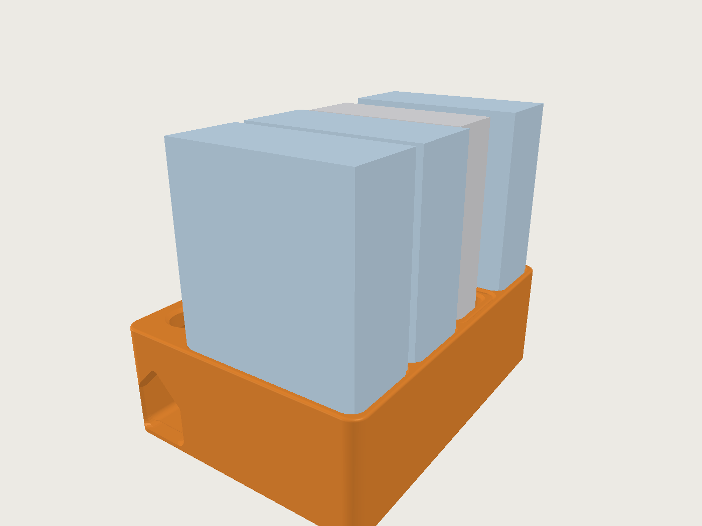

# powerbank-station

Parametric 3D-printed charging station for power banks. Banks stand upright, ports-up, in a row of slots,
with a closed cable box along one side: USB-C cables come in through an opening at the back, slack stays inside,
and a 16 mm hole beside each slot lets a plug come up to its bank.

Sized for the **Anker Zolo 20,000 mAh 30 W (built-in USB-C)**. A drop-in insert adapts any slot to the
**Zolo 10,000 mAh**. Mix them however you like; it's just a matter of how many inserts you print.

## Files

| File | What |
|---|---|
| `out/station_{1..6}.stl` | 1 to 6 slot stations |
| `out/insert_10k.stl` | 10K insert, one per slot that holds a 10K |
| `out/testfit.3mf`, `out/testfit_*.stl` | 8 mm test-fit slices of the 1-slot top and the insert top (about 16 g); print these first |
| `out/powerbank_station_4.3mf` | 4-slot + 1 insert, PrusaSlicer project (MK4 IS, 0.6 HF nozzle, Prusament PETG, 0.40 mm) |

## Details

- 1.0 mm clearance per side for the bank, 0.4 mm per side for the insert in its slot.
- Lead-in chamfers on every entrance: slot mouths, insert bottom and top, push-out holes, USB-C holes (top and underside).
- A 22 mm push-out hole in each slot floor: push a finger through to pop out a bank or an insert.
- The cable box ceiling is a teardrop arch (walls curving into 45° up to a 2 mm flat), so nothing needs supports.
- Prints as it sits, no supports. Tested slicing with a 0.6 mm nozzle at 0.40 mm layers; 2.6 mm dividers slice as 4 lines.

## Build

    uv run python station.py     # out/station_{1..6}.stl, out/insert_10k.stl
    uv run python render.py 4    # preview renders
    uv run python tools/make_3mf.py out/powerbank_station_4.3mf tools/petg_hf06.ini out/station_4.stl out/insert_10k.stl

Main knobs (`Params` in `station.py`): `slots`, `clear`, `depth`, `lean`, `div`, `cable` ("left" / "right" / "none"),
`cable_w`, `hole_d`, `push_d`. Change `Bank` sizes to fit a different power bank.

Other designs: [slatwall-accessories](https://github.com/nick-pape/slatwall-accessories).

License: CC BY-NC-SA 4.0.
